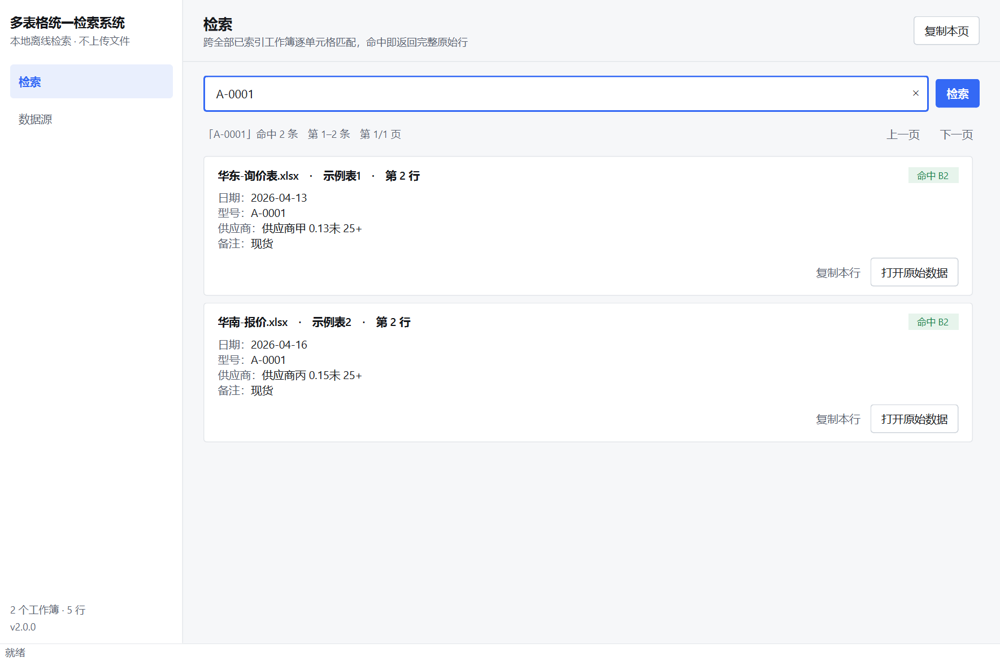
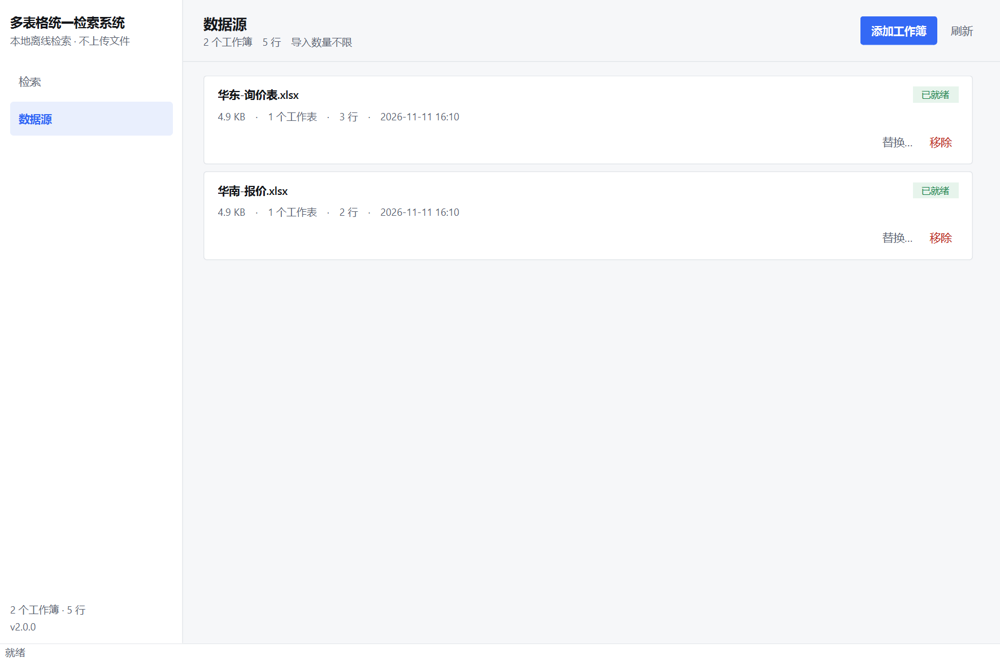

# 界面设计系统

界面按 **Retool** 设计规范实现。规范来自
[`ihlamury/design-skills`](https://github.com/ihlamury/design-skills) 的
`skills/retool/SKILL.md`（MIT），把 Web 设计系统的约束翻译成 Qt Widgets 的 QSS。

## 直接采用的规则

| 规范要求 | 本项目落地 |
| --- | --- |
| Inter 作为首选字体 | `QFont.setFamilies(["Inter", "Segoe UI", "Microsoft YaHei UI", ...])`，装了就生效，没装则回退系统字体 |
| 4px 间距栅格 | 所有 `setSpacing` / `setContentsMargins` 取 4 的倍数（4/8/12/16/24） |
| 圆角只取 2/3/4/19/32/99 | 控件 4px，状态标签 99px（胶囊） |
| 1px 边框分隔 | 卡片、输入框、导航栏分割线统一 1px |
| 2px 强调色焦点环，不可移除 | 输入框 `:focus` 用 2px 边框并回减 1px 内边距，避免布局跳动 |
| 禁用态 `opacity: .5` 的效果 | 禁用按钮用中性背景 + 次级文字色，等效于降透明度 |
| 数据用等宽数字 | 行数、文件大小等数值使用 `tabular-nums` 思路（等宽字形 + 千分位） |
| 破坏性操作必须二次确认 | 替换工作簿、移除工作簿都弹确认框，默认按钮是「取消」 |
| 错误显示在发生的位置 | 导入失败写进对应卡片的状态标签与状态栏，不用全局弹窗 |
| 不做无意义的动画 | 全部移除；只有系统级 hover / pressed 反馈 |

## 色板

| Token | 值 | 用途 |
| --- | --- | --- |
| `surface-base` | `#F6F7F9` | 页面背景 |
| `surface-raised` | `#FFFFFF` | 卡片、导航栏、输入框 |
| `surface-sunken` | `#EEF0F4` | hover、次级按钮底色 |
| `border-subtle` | `#E3E6EA` | 卡片与分割线 |
| `border-strong` | `#CDD3DA` | 输入框、次级按钮描边 |
| `text-primary` | `#14161A` | 正文（白底对比度 17.9:1） |
| `text-secondary` | `#5B6270` | 说明文字（6.1:1） |
| `text-tertiary` | `#8A919E` | 占位符 |
| `accent` | `#3469F5` | 主按钮、焦点环（白底 5.0:1） |
| `accent-hover` | `#2A57D0` | 主按钮 hover |
| `accent-weak` | `#E9EFFD` | 选中态背景、当前导航项 |
| `success` | `#1B7F4B` | 「已就绪」状态 |
| `warning` | `#8A5B00` | 「导入中」状态 |
| `danger` | `#B42318` | 「导入失败」、移除按钮 |

## 两处刻意偏离

规范里的两个 token 与它自己「正文对比度必须 ≥ 4.5:1」的硬要求冲突，实际取色做了调整：

1. **`surface-base` 从 `#E3E6D7` 改为 `#F6F7F9`。** `#E3E6D7` 是偏橄榄的米色，
   和白色卡片、蓝色强调色放在一起会让整个界面显脏；这是提取工具把某个装饰性色块
   当成了页面底色。改用中性浅灰后，卡片层次才立得住。
2. **`accent` 从 `#80AEF2` 改为 `#3469F5`。** `#80AEF2` 是浅蓝，白字压在上面的
   对比度只有 2.4:1，不满足规范自己的 4.5:1 要求。改用规范色板里另一个蓝色
   （`#3469F5`，白底 5.0:1）作为主操作色，`#80AEF2` 保留在浅色填充场景。

## 字号与层级

| 用途 | 字号 / 字重 |
| --- | --- |
| 页面标题 | 17px / 600 |
| 导航栏品牌 | 15px / 600 |
| 卡片标题、区块标题 | 13px / 600 |
| 正文、字段值 | 13px / 400 |
| 说明、元信息、字段名 | 12px / 400 |
| 状态标签 | 11px / 400 |

中文在 Inter 缺字时回退到「Microsoft YaHei UI」，行高与字重不会跳变。

## 组件

| 组件 | 规格 |
| --- | --- |
| 主按钮 | 蓝底白字、4px 圆角、`padding: 6px 12px`、最小高度 28px |
| 次级按钮 | 白底、1px `border-strong` 描边 |
| 幽灵按钮 / 危险按钮 | 无底色无描边，hover 才出现淡底 |
| 输入框 | 高 40px、4px 圆角，聚焦时 2px 强调色描边 |
| 卡片 | 白底、1px `border-subtle`、4px 圆角、内边距 16/12 |
| 状态标签 | 胶囊形，四色：已就绪（绿）/ 导入中（黄）/ 导入失败（红）/ 中性（灰） |
| 导航项 | 高 32px，选中时 `accent-weak` 底 + 强调色文字 + 600 字重 |

## 布局

- 左导航固定 216px，右侧内容区自适应
- 页面头部 56px，下面 24px 外边距的内容区
- 结果与工作簿都以卡片纵向排列，滚动区隐藏横向滚动条
- 默认窗口 1180×780，最小 960×620

## 截图

| 检索 | 数据源 |
| --- | --- |
|  |  |
